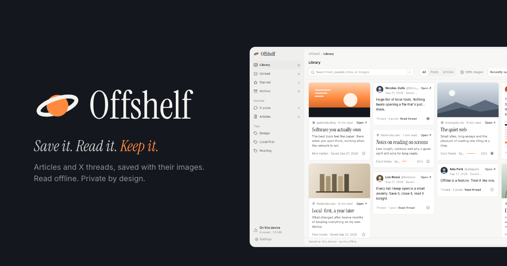
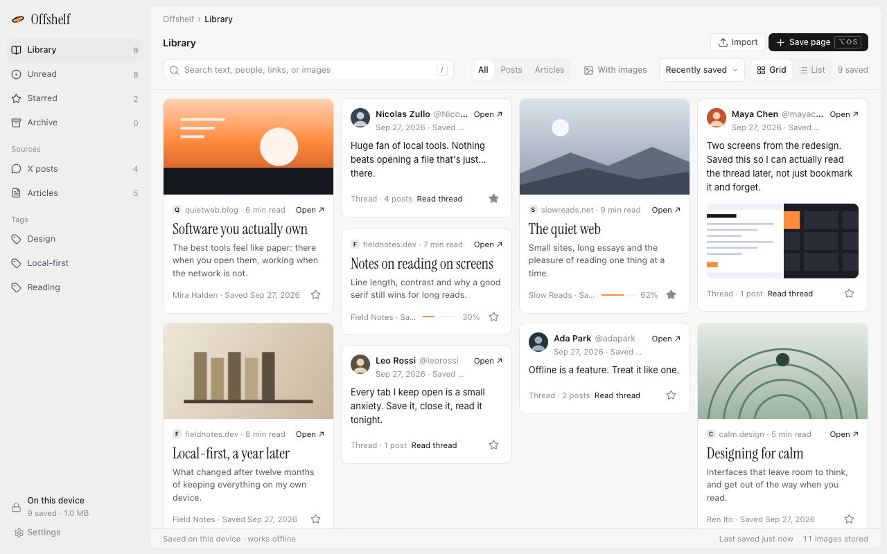
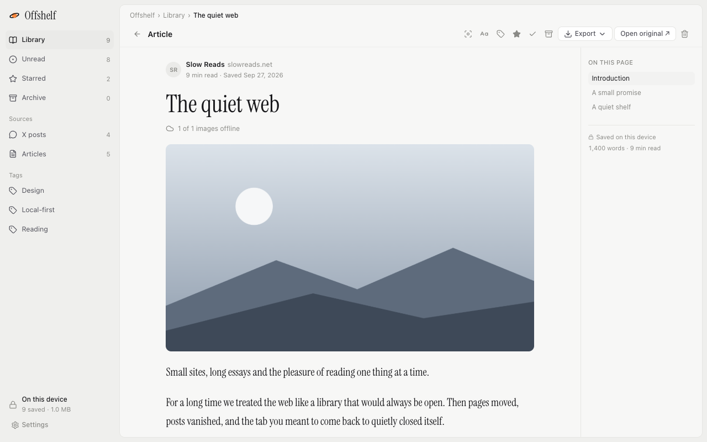
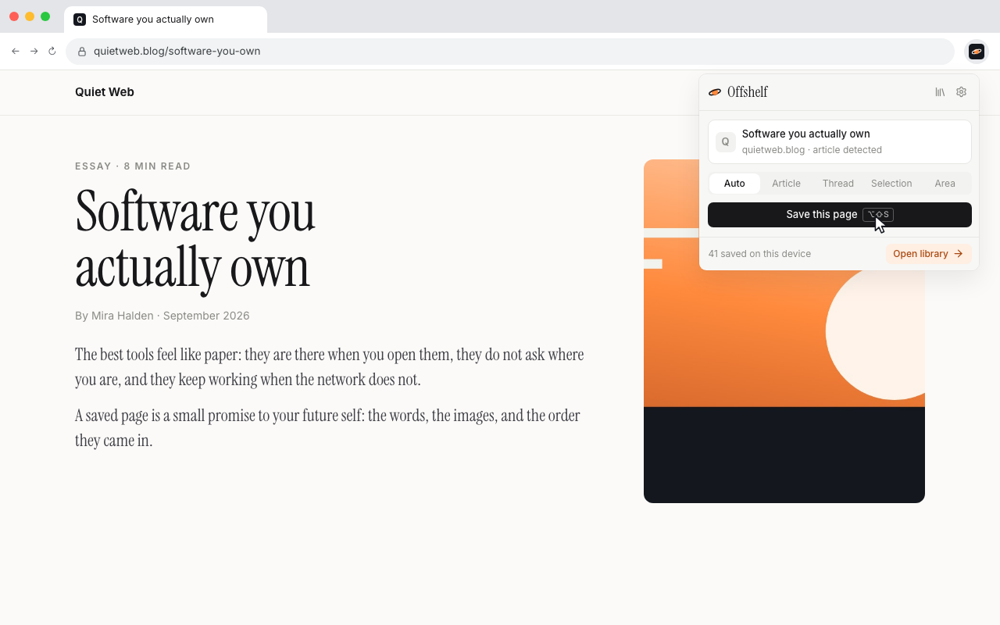
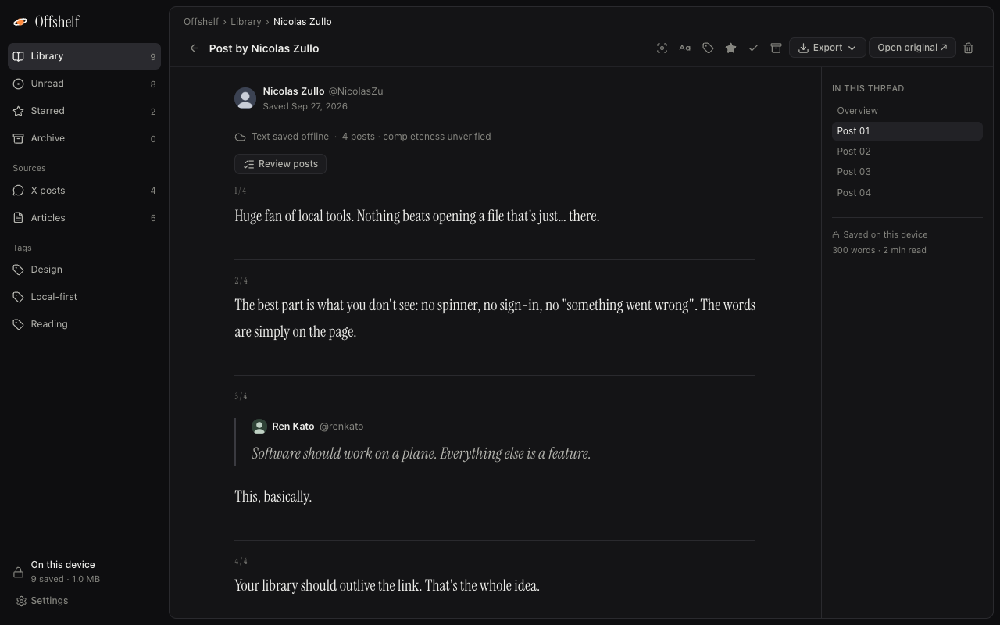

<p align="center">
  <a href="https://offshelf.zainzafar.net">
    
  </a>
</p>

<p align="center">
  <a href="https://chromewebstore.google.com/detail/oaihkpaflpdnhoecnlmajhhocgffoppo"><b>Add to Chrome</b></a>
  ·
  <a href="https://offshelf.zainzafar.net">Website</a>
  ·
  <a href="https://offshelf.zainzafar.net/privacy/">Privacy</a>
</p>

# Offshelf

Offshelf is a Chrome extension that saves articles and X threads, with their images,
into a calm library on your device. You can read them later, even offline, and export
them to HTML, Markdown or a print-ready PDF.

There's no account, no cloud, no analytics and no AI. Your library lives in your browser.

## Features

- **Save in one click.** Click the toolbar icon, press <kbd>Alt</kbd>+<kbd>Shift</kbd>+<kbd>S</kbd>,
  or right-click and choose **Save page to Offshelf**. **Auto** picks the right capture, or
  you can choose **Article**, **Thread**, **Selection** or **Area**.
- **Threads, kept whole.** An X thread is saved in order: the author's own posts, with
  avatars and quoted posts. Other people's replies are left out.
- **Images saved with the text.** Images are downloaded to your device, so a saved page
  still works when the original changes or goes away.
- **A calm library.** Search, Posts and Articles filters, tags, stars, an archive, and
  reading progress at a glance.
- **A reader that gets out of the way.** Serif or sans, text size, reading width, light or
  dark, an outline for long articles, and focus mode.
- **Export any time.** HTML with images inside, a Markdown ZIP with an assets folder, or a
  print-ready PDF. Back up and restore the whole library as one file.

<table>
  <tr>
    <td></td>
    <td></td>
  </tr>
  <tr>
    <td></td>
    <td></td>
  </tr>
</table>

## Privacy

- Offshelf stores everything in your browser's IndexedDB, on this device.
- It reads a page only when you ask it to save that page.
- Image downloads contact only the original image hosts, and Chrome asks for access to each
  host when it's first needed. Offshelf has no permanent access to any website.
- It doesn't bypass paywalls or recover private, deleted or unloaded posts.

Full policy: [offshelf.zainzafar.net/privacy](https://offshelf.zainzafar.net/privacy/).

## Develop

You need Node 22 and pnpm 10.

```bash
pnpm install
pnpm dev          # Chrome with the extension loaded and hot reload
pnpm check        # typecheck, lint, build, unit tests
pnpm test:e2e     # Playwright against the built extension
pnpm lint:fix     # apply the spacing rule
pnpm zip          # store package in .output/
```

To try a build in your own Chrome, run `pnpm build`, open `chrome://extensions`, turn on
**Developer mode**, click **Load unpacked** and pick `.output/chrome-mv3`.

### How it fits together

```
toolbar / shortcut / menu
          │
          ▼
  background worker ──── capture script (runs in the page you save)
          │                    │
          │  offshelf:* messages, checked at runtime
          ▼                    ▼
   IndexedDB (offshelf-library) ◄── library, reader and popup pages
```

| Folder | What lives there |
|---|---|
| `src/background` | Service worker: capture jobs, job recovery, image downloads with retries |
| `src/capture` | Content script that turns a page or X thread into clean blocks |
| `src/storage` | IndexedDB stores, backup, and the only wrappers around `chrome.*` for pages |
| `src/core` | Data model, validation, the worker message contract, small pure helpers |
| `src/features` | Pure UI logic (filters, popup phase, tags), unit-tested |
| `src/surfaces` | React pages: library, reader, popup, settings |
| `src/ui` | shadcn-style primitives |
| `src/exports` | HTML, Markdown ZIP and print output |
| `entrypoints` | WXT entry points for each page and script |

[`CLAUDE.md`](CLAUDE.md) has the engineering rules. In short: IndexedDB is the source of
truth, every document is validated before it's stored, and browser APIs stay in
`background`, `capture` and `storage`.

### Tests

- `tests/` has more than 1,000 Vitest tests covering the worker, storage, capture
  parsing, exports and every page (jsdom with fake-indexeddb).
- `e2e/` loads the built extension in Chromium with Playwright and runs the main flows:
  samples, reader, export, print, settings and popup.
- Run `pnpm test:e2e` for any change to pages, capture or the worker.

## Publish

`publish/` holds the Chrome Web Store kit (listing copy, privacy policy, screenshots,
promo tiles, upload ZIP), the showreel and its source. The website in `site/` deploys with
`pnpm site:deploy`. See [`publish/README.md`](publish/README.md).

---

<p align="center">
  Made by <a href="https://zainzafar.net">zainzafar.net</a>
</p>
